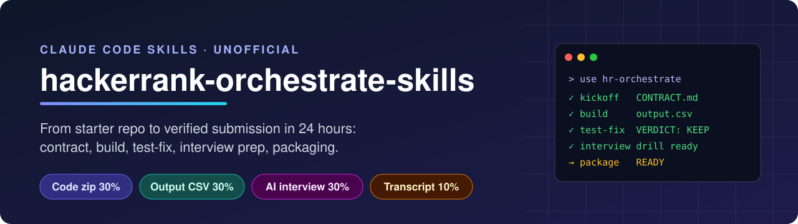
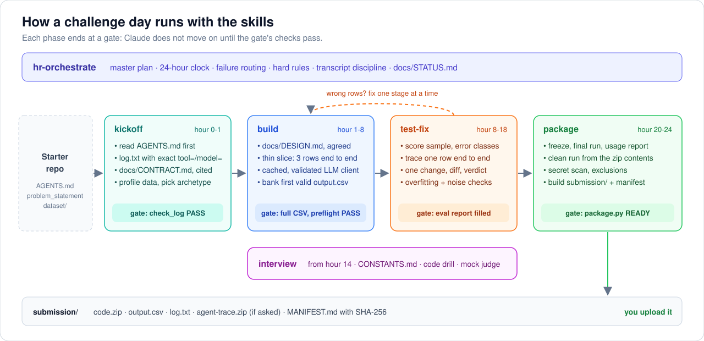
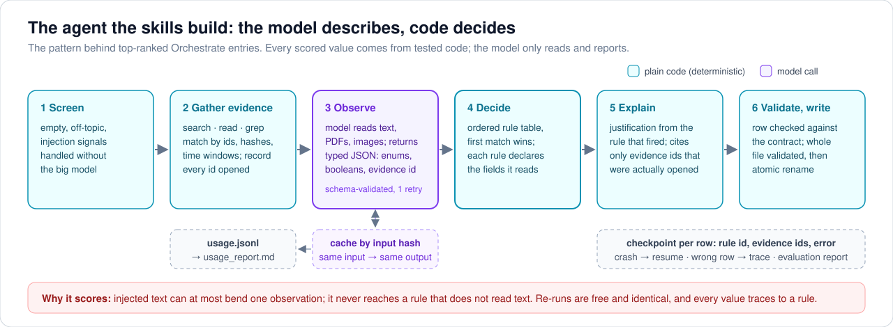
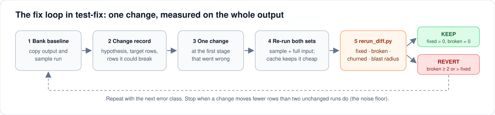
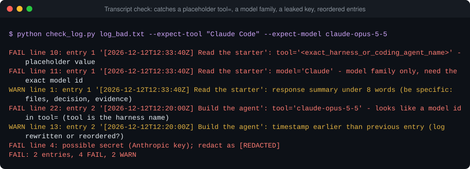
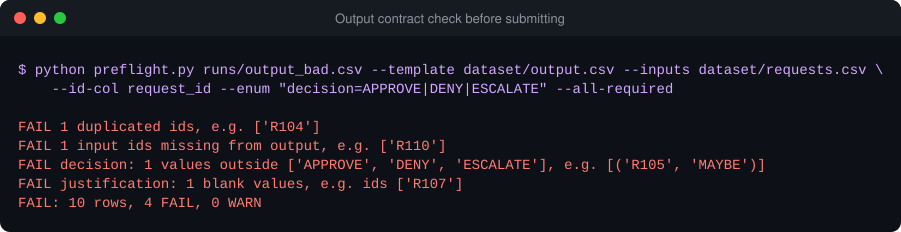
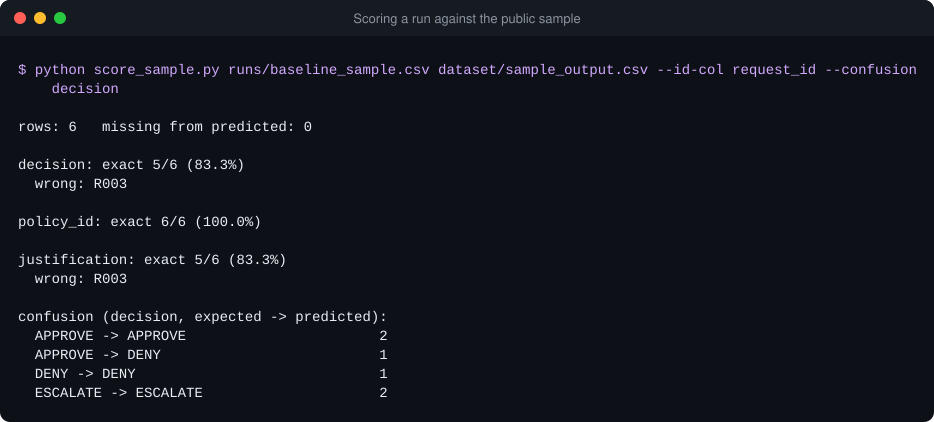
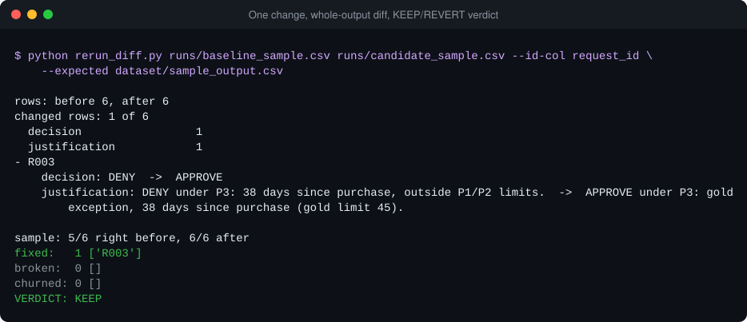
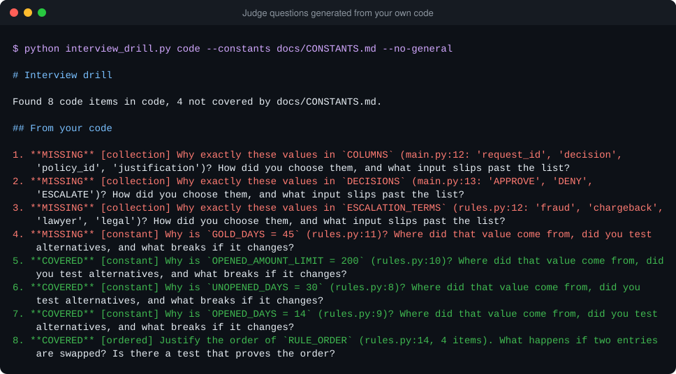

<p align="center">
  
</p>

<p align="center">
  <a href="https://github.com/Aswin-Times/hackerrank-orchestrate-skills/actions/workflows/ci.yml"></a>
  
  
  
</p>

**Six Claude Code skills that take you through HackerRank Orchestrate,** the 24-hour hackathon where you build an AI agent and are scored on four things: your code, your output CSV, a 30-minute interview with an AI judge, and the chat transcript with your coding assistant.

Install them, open the challenge's starter repo in Claude Code, and say `use hr-orchestrate`. Claude then works through the day with you: reads the rules, sets up transcript logging correctly, designs and builds the agent, measures and fixes it, prepares you for the interview using your own code, and checks the submission before you upload it.

> Unofficial; not affiliated with HackerRank. The starter repo's own `AGENTS.md` and problem statement always win over anything in these skills.

## Contents

- [Quick start](#quick-start)
- [How it works](#how-it-works)
- [What to say at each step](#what-to-say-at-each-step)
- [See it in action](#see-it-in-action)
- [The skills](#the-skills)
- [The scripts](#the-scripts)
- [Install options](#install-options)
- [FAQ](#faq)
- [Repository layout](#repository-layout)
- [Development](#development)
- [Research and credits](#research-and-credits)

## Quick start

**1. Install** (Windows PowerShell):

```powershell
git clone https://github.com/Aswin-Times/hackerrank-orchestrate-skills.git
```

```powershell
.\hackerrank-orchestrate-skills\scripts\install.ps1
```

macOS / Linux:

```sh
git clone https://github.com/Aswin-Times/hackerrank-orchestrate-skills.git
./hackerrank-orchestrate-skills/scripts/install.sh
```

This copies six folders into `~/.claude/skills/`. Nothing else is installed; the scripts use only the Python standard library.

**2. Open the starter repo** HackerRank gives you in Claude Code.

**3. Send your first message:**

```text
Use hr-orchestrate. This is the Orchestrate starter repo. Run kickoff: read AGENTS.md and the
problem statement, set up logging, and write docs/CONTRACT.md. Don't write agent code yet.
```

From there Claude follows the phases below and tells you which gate it is working towards.

## How it works

### The day, phase by phase

<p align="center">
  
</p>

`hr-orchestrate` is the entry point. It holds the plan, the 24-hour clock, the hard rules and a table that says which skill to open when something goes wrong. Each phase skill ends at a **gate**: a short list of checks that must pass before moving on, so problems are caught when they are cheap.

| Phase | Hours | Claude does | Gate (must pass) |
|---|---|---|---|
| **kickoff** | 0-1 | Reads `AGENTS.md` first, writes the transcript log in the exact required format, extracts the output contract, profiles the data, picks one of five problem archetypes | `check_log.py` passes; `docs/CONTRACT.md` written |
| **build** | 1-8 | Writes `docs/DESIGN.md` and agrees it with you, builds a 3-row thin slice, then the full agent with a cached, schema-validated model client | Valid `output.csv` for every row; a copy banked |
| **test-fix** | 8-18 | Scores the sample, groups wrong rows into error classes, traces one row end to end, fixes one thing at a time, checks overfitting and run-to-run noise | Evaluation report filled from real runs |
| **interview** | from 14 | Records where every constant came from, generates judge questions from your code, runs a mock interview | Every constant covered; mock interview done |
| **package** | 20-24 | Freezes code, does a clean run from the zip contents, scans for secrets, builds `submission/` | `package.py` reports READY |

### Files Claude keeps in your challenge repo

| File | Purpose |
|---|---|
| `docs/STATUS.md` | Current phase, last gate passed, latest numbers, next step. After a context reset, Claude reads this and carries on. |
| `docs/CONTRACT.md` | Every output rule with the line it came from, plus the assumptions you agreed to |
| `docs/DESIGN.md` | Architecture, where the model is used versus code, rule table, failure table, rejected ideas |
| `docs/experiments.md` | One change record per fix, with before/after numbers and a KEEP or REVERT verdict |
| `docs/CONSTANTS.md` | Where each number in the code came from (from the problem statement, measured, a standard default, a safety limit, or a judgement call) |
| `evaluation/` | Evaluation report, usage report, custom test cases |

### The agent it builds

<p align="center">
  
</p>

The build skill defaults to the design used by top-ranked entries: **the model describes, code decides.** The model reads messy inputs (text, PDFs, images) and returns typed facts, each tied to the evidence it came from. A plain, tested rule table turns those facts into every scored value. Because of this:

- the same input gives the same output (model calls are cached by input hash);
- each output can be traced to the rule that produced it, which is exactly what the AI judge asks about;
- prompt injection hidden in the data can at most bend one observation; it cannot reach a rule that does not read text;
- justifications cite only evidence the agent actually opened.

You can change the design; the skill just asks you to record why in `DESIGN.md`.

### How fixes are kept honest

<p align="center">
  
</p>

Every fix is a single change with a written hypothesis. After re-running, `rerun_diff.py` compares the whole output, not just the row you were fixing, and says KEEP, REVERT or REVIEW. This stops the classic mistake of fixing one sample row while silently breaking others, or tuning to the sample until it no longer generalises.

## What to say at each step

You stay in charge; your prompts go into the graded transcript word for word, so specific prompts score better. Some examples:

| When | Example prompt |
|---|---|
| Start | `Use hr-orchestrate. Run kickoff on this starter repo. Don't write agent code yet.` |
| After kickoff | `Contract looks right. Assumption 2: use the stricter reading. Now use hr-orchestrate-build and draft DESIGN.md.` |
| Design review | `Approve the design, but drop the reranker: we have 3 hours left for build. Start with the 3-row thin slice.` |
| First full run | `Use hr-orchestrate-test-fix. Score the sample and group the wrong rows by cause.` |
| Fixing | `Rows S014 and S021 are wrong because the restore event is ignored. Fix only that rule and show me the rerun_diff verdict.` |
| Mid-day | `Use hr-orchestrate-interview. Start CONSTANTS.md and give me 5 drill questions.` |
| Lost or broken | `Use hr-orchestrate. The run crashes at row 212 with a timeout. What does the failure table say?` |
| After a context reset | `Read docs/STATUS.md and continue with hr-orchestrate.` |
| Final hours | `Use hr-orchestrate-package. Are we ready to submit? Run every check.` |
| Rehearsal | `Be the AI judge. Ask me one question at a time and check my answers against the code.` |

## See it in action

These are real outputs of the bundled scripts, run on the small fictional challenge in [`examples/demo`](examples/demo). You can reproduce every one in under a minute (see [Try it yourself](#try-it-yourself)).

**Transcript check.** Catches a placeholder `tool=`, a bare model family, a model id in the wrong field, a leaked API key, and entries out of order:



**Output contract check.** Run on every output before anyone sees it:



**Scoring against the sample.** Per-column accuracy, the wrong ids, and a confusion matrix:



**One change, whole-output diff, verdict.** The fix for R003 is kept because nothing else broke:



**Interview drill from your own code.** Items missing from `docs/CONSTANTS.md` come first, because those are the questions you are least ready for:



### Try it yourself

```sh
cd examples/demo
python code/main.py
python ../../skills/hr-orchestrate-test-fix/scripts/rerun_diff.py runs/baseline_sample.csv runs/candidate_sample.csv --id-col request_id --expected dataset/sample_output.csv
```

[`examples/demo/README.md`](examples/demo/README.md) lists a command for every script.

## The skills

| Skill | Use it when | You get |
|---|---|---|
| [`hr-orchestrate`](skills/hr-orchestrate/SKILL.md) | At the start, when lost, when anything fails | The plan, phase gates, 24-hour clock, failure routing, hard rules, transcript tips, patterns from winners, how past editions differed |
| [`hr-orchestrate-kickoff`](skills/hr-orchestrate-kickoff/SKILL.md) | The starter repo has just arrived | `docs/CONTRACT.md`, verified logging, data profile, archetype |
| [`hr-orchestrate-build`](skills/hr-orchestrate-build/SKILL.md) | The contract is written | `docs/DESIGN.md`, a working agent, a valid full `output.csv`, usage report |
| [`hr-orchestrate-test-fix`](skills/hr-orchestrate-test-fix/SKILL.md) | A full output exists | Sample scores, error classes, change records, overfitting and noise checks, evaluation report |
| [`hr-orchestrate-interview`](skills/hr-orchestrate-interview/SKILL.md) | From mid-build onwards | `docs/CONSTANTS.md`, drill questions, a mock interview with feedback |
| [`hr-orchestrate-package`](skills/hr-orchestrate-package/SKILL.md) | The final hours | Readiness checks, clean-run check, `submission/` with a SHA-256 manifest |

Each `SKILL.md` is short and points to reference files that Claude opens only when needed, so little of your context window is used up.

## The scripts

Python standard library only (tested on 3.10 and 3.12). Every script takes file paths and column names as arguments, contains no dataset, and prints help with `--help`. Claude runs them for you; you can also run them yourself.

| Script | What it checks |
|---|---|
| [`check_log.py`](skills/hr-orchestrate-kickoff/scripts/check_log.py) | Each log entry has exactly one valid `tool=` and `model=`, required sections, ordered timestamps, no secrets, no "processed row N" spam |
| [`contract_extract.py`](skills/hr-orchestrate-kickoff/scripts/contract_extract.py) | MUST / NEVER lines, CSV headers, required files, allowed values and URLs, each with file:line; `--diff` compares two editions |
| [`profile_data.py`](skills/hr-orchestrate-kickoff/scripts/profile_data.py) | Row counts, likely enums, JSON shapes and key orders, header mismatches, id overlap between files |
| [`usage_report.py`](skills/hr-orchestrate-build/scripts/usage_report.py) | Writes `evaluation/usage_report.md` from a per-call token log: calls, tokens, cost, per-request averages, cache hits |
| [`preflight.py`](skills/hr-orchestrate-test-fix/scripts/preflight.py) | Exact header, one row per input id, allowed values, valid JSON, no blanks, JSON key order versus the sample |
| [`score_sample.py`](skills/hr-orchestrate-test-fix/scripts/score_sample.py) | Per-column accuracy, step-level precision/recall/F1, field-level and sequence accuracy, confusion matrix |
| [`rerun_diff.py`](skills/hr-orchestrate-test-fix/scripts/rerun_diff.py) | What changed between two runs; fixed, broken and churned rows; KEEP / REVERT / REVIEW |
| [`coupling_scan.py`](skills/hr-orchestrate-test-fix/scripts/coupling_scan.py) | Sample ids or values copied into your code (a sign of overfitting) |
| [`interview_drill.py`](skills/hr-orchestrate-interview/scripts/interview_drill.py) | Judge questions from your constants, thresholds, model settings and lists; what CONSTANTS.md does not cover |
| [`package.py`](skills/hr-orchestrate-package/scripts/package.py) | Submission readiness and secret scan; builds `code.zip`, `output.csv`, `log.txt`, optional `agent-trace.zip` and a manifest |

## Install options

| Goal | Command |
|---|---|
| All projects (Windows) | `.\scripts\install.ps1` |
| All projects (macOS / Linux) | `./scripts/install.sh` |
| One challenge repo only | `.\scripts\install.ps1 -Project C:\path\to\repo` or `./scripts/install.sh --project /path/to/repo` |
| Update | `git pull`, then run the install command again (it replaces the old copies) |
| Remove | Delete the `hr-orchestrate*` folders from `~/.claude/skills/` |

The `hr-` prefix keeps these separate from other Orchestrate skill sets you may already have.

## FAQ

**Does Claude write the whole agent for me?**
Claude builds it with you. It proposes the contract reading, the design and each fix, and you approve or change them. That back-and-forth is what the transcript is graded on, and you will need to explain the system in the interview, so stay involved.

**Do I need an API key?**
Not for the skills or scripts. The agent you build will usually call a model, and the skills make it read the key from an environment variable, never from code.

**Will it work if the rules change in the next edition?**
That is expected. Kickoff reads the new `AGENTS.md` and problem statement first and writes the contract from them; the skills defer to the starter wherever they differ. [`editions.md`](skills/hr-orchestrate/references/editions.md) lists what changed between past editions so you know where to look.

**Can I use these with Codex, Cursor or another agent?**
The skills are plain Markdown and the scripts are plain Python. Point the other agent at [`skills/INDEX.md`](skills/INDEX.md), or paste `skills/hr-orchestrate/SKILL.md` into its instruction file. The automatic skill loading is a Claude Code feature.

**Is using these allowed?**
Orchestrate explicitly lets you use AI coding tools. These skills guide the process and run checks; the agent code is written fresh in your session. Read the current edition's rules to be sure, and never submit anything you cannot explain.

**I already have NITISH-R-G's orchestrate skills installed. Will they clash?**
No. The names differ (`hr-orchestrate*` versus `orchestrate*`). To avoid confusion, tell Claude which set to use.

## Repository layout

```text
skills/
  hr-orchestrate/            start here: plan, rules, routing   (+ references/)
  hr-orchestrate-kickoff/    contract + logging                 (+ references/, scripts/)
  hr-orchestrate-build/      design + agent                     (+ references/, scripts/)
  hr-orchestrate-test-fix/   scoring + fix loop                 (+ references/, scripts/)
  hr-orchestrate-interview/  constants + drill                  (+ references/, scripts/)
  hr-orchestrate-package/    final gate + submission            (+ references/, scripts/)
  INDEX.md                   which skill to open when
examples/demo/               fictional mini-challenge to try every script
assets/                      diagrams and screenshots used in this README
scripts/                     install.ps1, install.sh, make_screenshots.py
tests/                       unittest suite for every script and SKILL.md
RESEARCH.md                  survey of existing Orchestrate skills and winning entries
```

## Development

```sh
python -m unittest discover -s tests -v     # SKILL.md structure + every script
python scripts/make_screenshots.py          # regenerate assets/screenshots from real runs
```

CI runs the tests on Linux and Windows with Python 3.10 and 3.12. Contributions are welcome: keep each `SKILL.md` short, put detail in `references/`, keep scripts standard-library only, and add a test for any new script.

## Research and credits

Before writing these skills we surveyed the existing Orchestrate skill sets ([NITISH-R-G/hackerrank-orchestrate-skills](https://github.com/NITISH-R-G/hackerrank-orchestrate-skills), [santheesh73/Orchestrate-skill](https://github.com/santheesh73/Orchestrate-skill)), the public repos and write-ups of top finishers, and HackerRank's official starter repos. [RESEARCH.md](RESEARCH.md) has the findings and links. All text and code in this repository are original.
